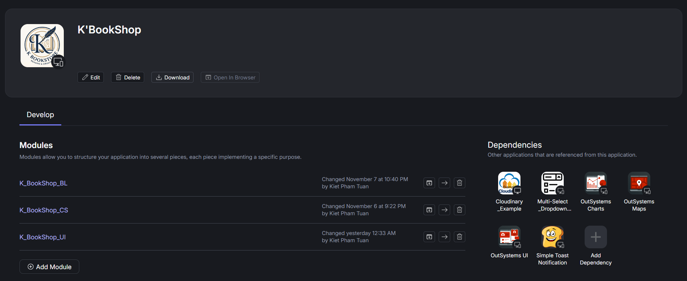
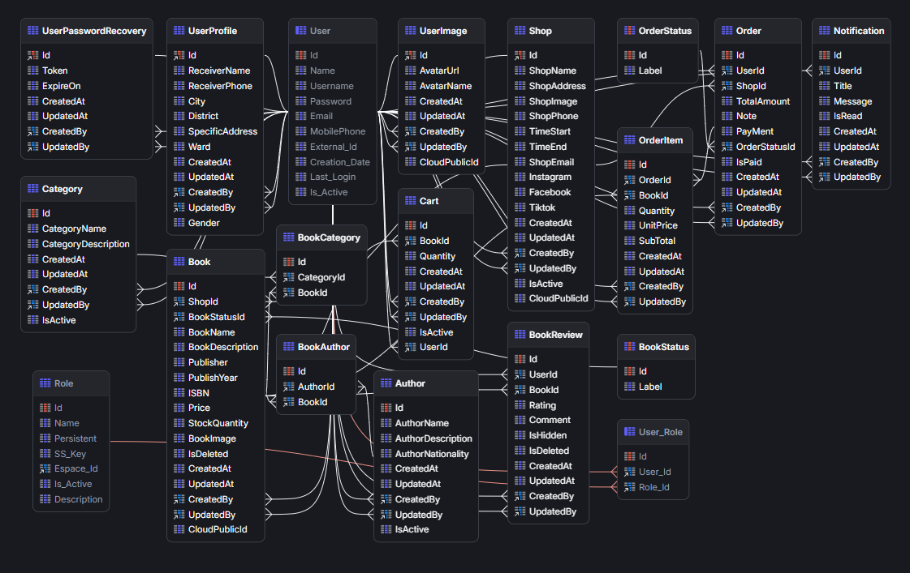
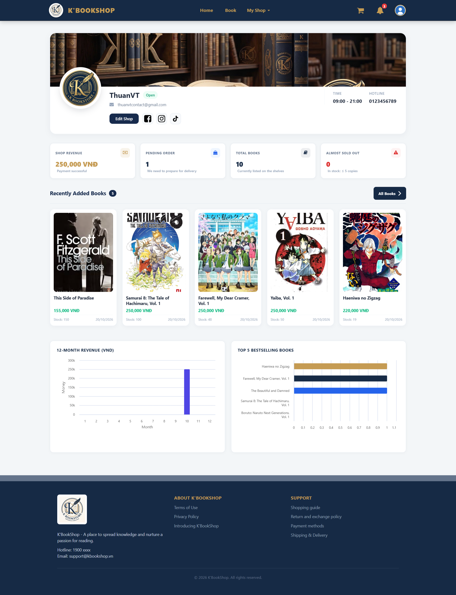
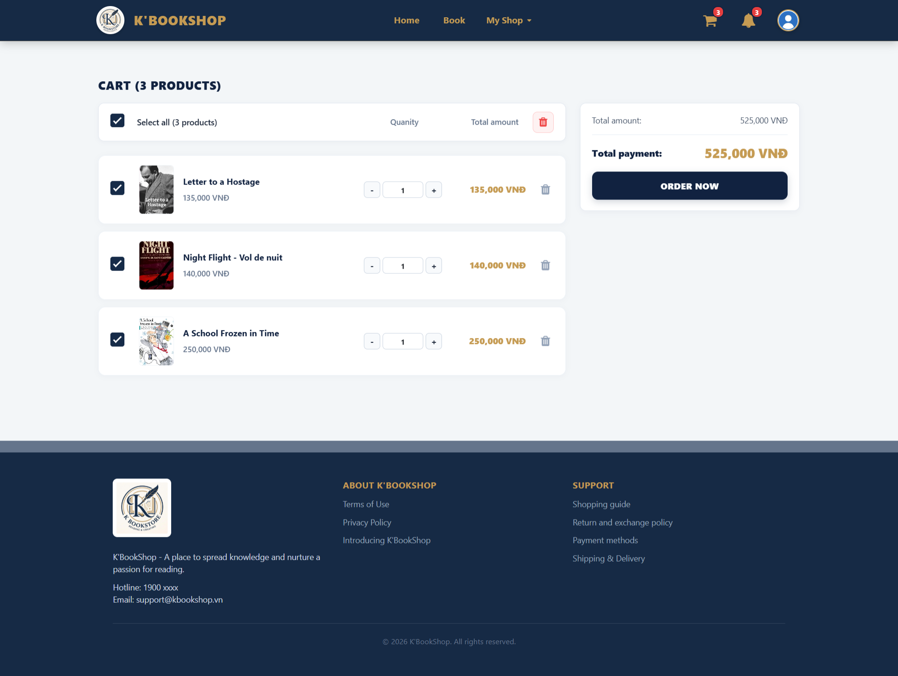
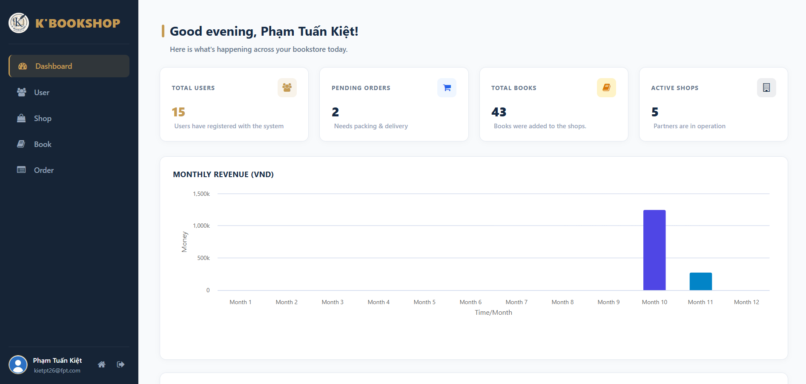

# K'BookShop - Nền Tảng Thương Mại Điện Tử Sách Trực Tuyến

**Hệ thống sàn thương mại điện tử chuyên biệt dành cho sách & xuất bản phẩm, xây dựng trên nền tảng OutSystems 11 Reactive Web (Cross-Device).**

---

## Giới Thiệu Tổng Quan

**K'BookShop** là nền tảng thương mại điện tử đa người bán (Multi-Vendor Marketplace) phục vụ việc mua bán, trao đổi sách và các ấn phẩm văn hóa. Dự án được thiết kế và phát triển tối ưu theo tiêu chuẩn công nghệ của **OutSystems 11 (Reactive Web)**, hỗ trợ hiển thị linh hoạt trên mọi loại thiết bị (Desktop, Tablet, Mobile).

Dự án áp dụng mô hình phân tách nghiệp vụ đa tầng (4-Layer Architecture Canvas), giúp hệ thống đạt độ mở rộng cao (scalability), dễ bảo trì, chuẩn hóa quy trình từ khâu duyệt sách, quản lý gian hàng, giỏ hàng, đặt hàng đến xử lý khiếu nại và phản hồi từ độc giả.

Link project: [K'BookShop - Giving Wings to Knowledge](https://personal-wq8yxgj3.outsystemscloud.com/K_BookShop_UI/Home)

---

## Điểm Nổi Bật

- **Mô hình Sàn đa nhà bán (Multi-Shop):** Cho phép nhiều nhà sách/chủ tiệm sách (`ShopOwner`) đăng ký mở gian hàng, đăng bán sách và quản lý đơn hàng riêng biệt.
- **Xác thực đa phương thức:** Hỗ trợ đăng nhập truyền thống, đăng ký tài khoản với quy trình xác minh mã **OTP qua Email**, và hỗ trợ **Single Sign-On (SSO) qua Google People API**.
- **Chuẩn hóa dữ liệu quốc tế:** Kiểm tra tính hợp lệ và duy nhất của mã sách quốc tế ISBN , Email, Username, tên Shop.
- **Tương tác độc giả:** Hệ thống đánh giá, bình luận sách (`BookReview`),  và hộp thư thông báo thời gian thực (`Notification`).
- **Giao diện người dùng sang trọng (UX/UI):** Tone màu chủ đạo `#162b48` (Navy Blue) kết hợp giao diện thẻ hiện đại, hiệu ứng tải trang mượt mà và các thành phần bố cục dùng lại (Reusable Web Blocks).

---

## Kiến Trúc Hệ Thống (4-Layer Canvas)

Hệ thống được đóng gói trong Solution `K_BookShop` với 3 module chính tuân thủ chặt chẽ tiêu chuẩn **Architecture Canvas** của OutSystems:

### 1. `K_BookShop_CS` (Core Services)
- Quản lý cấu trúc dữ liệu toàn hệ thống gồm **15 Core Entities** và **2 Static Entities**.
- Cung cấp hơn **60 Server Actions** chuẩn CRUD (Create, Update, Delete, CreateOrUpdate) được đóng gói dạng Public API có kiểm soát toàn vẹn dữ liệu.
- Định nghĩa các vai trò hệ thống (`Roles`): `Admin`, `ShopOwner`, `UserBook`.

### 2. `K_BookShop_BL` (Business Logic)
- Xử lý các quy tắc nghiệp vụ phức tạp:
  - **Tài khoản & Xác thực:** `DoLogin`, `DoSignUp`, `Google_LoginWithPeopleAPI`, `SendOTP`, `VerifyOTP`, `ResetPassword`, `ChangedPassword`.
  - **Cửa hàng:** `CreateShop`, `UpdateShop`, `CheckShopName`, `ToggleStatusShop`, `UpdateShopAdmin`.
  - **Sách:** `CreateBookShop`, `UpdateBookShop`, `DeleteBookShop`, `CheckISBN`, `ToggleBookStatusAdmin`.
  - **Giỏ hàng & Đơn hàng:** `AddBookToCart`, `UpdateCart`, `DeleteCart`, `ClearAll`, `CreateOrder`, `UpdateOrderStatus`, `CancelOrder`, `CancelOderByAdmin`.
  - **Tương tác:** `CreateBookReview`, `UpdateBookReview`, `GetReview`, `MarkAsRead`, `MarkAllAsRead`.
- Quản lý theme gửi email thông báo/OTP (`EmailTheme`).

### 3. `K_BookShop_UI` (User Interface)
- Tầng giao diện người dùng Reactive Web:
  - **Web Flows:** `MainLayout`, `Layouts`, `Common`.
  - **Reusable Blocks:** `Header`, `Footer`, `SideMenu`, `LayoutTopMenu`, `LayoutSideMenu`, `NotificationList`, `UserInfo`, `LoadingWrapper`, `ApplicationTitle`, `MenuIcon`.
  - **Assets:** Ảnh logo thương hiệu (`Logo.jpg`), hình nền đăng nhập (`Background.jpg`), Avatar người dùng (`UserAvatar`), icon.

---

## Mô Hình Dữ Liệu (Entities & Schema)

### Danh sách Thực thể (Core Entities)

| Thực Thể (Entity) | Mô Tả Nghiệp Vụ |
| :--- | :--- |
| **`Book`** | Lưu trữ thông tin chi tiết về sách: Tiêu đề, mô tả, giá bìa, giá khuyến mãi, số lượng tồn kho, mã ISBN, năm xuất bản, hình ảnh, trạng thái... |
| **`Shop`** | Thông tin cửa hàng / gian hàng bán sách: Tên shop, mô tả, logo, địa chỉ, trạng thái hoạt động, người sở hữu... |
| **`Category`** | Danh mục / thể loại sách (Văn học, Kinh tế, Công nghệ, Thiếu nhi, Kỹ năng sống...). |
| **`BookCategory`** | Bảng trung gian liên kết đa - đa ($N-N$) giữa `Book` và `Category`. |
| **`Author`** | Thông tin tác giả: Tên tác giả, tiểu sử, ảnh chân dung... |
| **`BookAuthor`** | Bảng trung gian liên kết đa - đa ($N-N$) giữa `Book` và `Author`. |
| **`Cart`** | Giỏ hàng của từng người dùng, lưu trữ các đầu sách được chọn và số lượng mua. |
| **`Order`** | Thông tin đơn đặt hàng: Mã đơn, ngày đặt, tổng thanh toán, địa chỉ nhận hàng, phương thức thanh toán, trạng thái giao vận. |
| **`OrderItem`** | Chi tiết các mặt hàng trong đơn: Sách, số lượng, đơn giá tại thời điểm đặt hàng. |
| **`BookReview`** | Nhận xét, chấm điểm số sao (Rating) và đánh giá sách của khách hàng sau khi mua. |
| **`BookFavorite`** | Danh sách sách yêu thích (Wishlist) của từng người dùng. |
| **`UserProfile`** | Thông tin bổ sung cho hồ sơ cá nhân của người dùng (số điện thoại, ngày sinh, địa chỉ giao hàng mặc định). |
| **`UserImage`** | Quản lý tệp hình ảnh đại diện (Avatar) của người dùng. |
| **`UserPasswordRecovery`** | Quản lý quy trình khôi phục mật khẩu, lưu vết mã xác minh OTP, thời gian hết hạn của mã. |
| **`Notification`** | Quản lý thông báo trong ứng dụng (thông báo đơn hàng, cập nhật sách, trạng thái duyệt tài khoản, v.v.). |

### Thực thể Tĩnh (Static Entities)
- **`BookStatus`**: Các trạng thái vòng đời của một ấn bản sách (Chờ duyệt, Đang bán, Tạm dừng, Hết hàng, Đã gỡ bỏ).
- **`OrderStatus`**: Tiến trình xử lý đơn hàng (Chờ xác nhận, Đang đóng gói, Đang giao hàng, Giao thành công, Đã hủy).

---

## Phân Quyền Người Dùng (RBAC)

Hệ thống triển khai 3 vai trò (Roles) chính:

### 1. `Admin` (Quản trị viên sàn)
- Duyệt và quản lý trạng thái các gian hàng.
- Duyệt sách, ẩn/hiển thị sách vi phạm quy định.
- Quản lý danh mục sách toàn sàn và danh sách tác giả.
- Can thiệp xử lý và hủy đơn hàng khi xảy ra tranh chấp.
- Tạo và kích hoạt/khóa tài khoản người dùng.

### 2. `ShopOwner` (Chủ nhà sách / Người bán hàng)
- Đăng ký thông tin mở cửa hàng, cập nhật hồ sơ shop.
- Đăng bán sách mới, cập nhật giá, tồn kho và hình ảnh sách.
- Kiểm tra tính hợp lệ của mã ISBN sách khi nhập kho.
- Tiếp nhận và cập nhật tiến độ xử lý đơn hàng của shop.

### 3. `UserBook` (Độc giả / Khách mua hàng)
- Tìm kiếm sách, lọc theo thể loại, tác giả, mức giá.
- Xem chi tiết sách, đọc đánh giá của cộng đồng.
- Thêm sách vào giỏ hàng, tăng giảm số lượng hoặc xóa.
- Tiến hành đặt hàng, chọn thông tin giao nhận, hủy đơn khi đơn chưa vận chuyển.
- Đánh giá và bình luận về sách đã mua.
- Lưu sách vào danh mục yêu thích (Chưa hoàn thiện).
- Nhận thông báo trạng thái đơn hàng thời gian thực.
- Cập nhật thông tin cá nhân và ảnh đại diện.

---

## Danh Sách Tính Năng Chi Tiết

### 1. Phân Hệ Xác Thực & Tài Khoản
- **Đăng ký tài khoản mới (`DoSignUp`):** Kiểm tra hợp lệ email (`CheckEmail`) và tên đăng nhập (`CheckUserName`).
- **Đăng nhập (`DoLogin`):** Kiểm tra tài khoản có đang bị khóa hay không (`CheckUserIsActive`), phân loại phân quyền chuyển hướng (`CheckRole`).
- **Đăng nhập mạng xã hội:** Tích hợp Google SSO qua **Google People API** (`Google_LoginWithPeopleAPI`).
- **Quên mật khẩu & OTP:**
  - Gửi mã xác thực một lần qua email (`SendOTP`) với giao diện thư chuyên nghiệp (`EmailTheme`).
  - Kiểm tra và xác thực OTP trong thời gian hiệu lực (`VerifyOTP`).
  - Cho phép đặt lại mật khẩu mới bảo mật (`ResetPassword`, `ChangedPassword`).

### 2. Phân Hệ Quản Lý Sách & Danh Mục
- Đầy đủ chức năng phân loại sách đa danh mục (`BookCategory`) và đa tác giả (`BookAuthor`).
- Xác thực chuẩn mã vạch quốc tế ISBN (`CheckISBN`) nhằm tránh trùng lặp dữ liệu sách.
- Hỗ trợ lưu trữ ảnh bìa sách và tải lên kho dữ liệu hình ảnh.

### 3. Phân Hệ Giỏ Hàng & Mua Sắm
- Quản lý giỏ hàng linh hoạt: Thêm sản phẩm, cập nhật số lượng theo tồn kho thực tế, xóa từng mục hoặc làm trống toàn bộ giỏ.
- Tính toán tổng tiền, chiết khấu và phí vận chuyển tự động.

### 4. Phân Hệ Đơn Hàng & Giao Vận
- Quy trình đặt hàng rõ ràng từng bước.
- Cập nhật trạng thái đơn hàng theo thời gian thực (State Machine quản lý qua `OrderStatus`).
- Hỗ trợ cơ chế hủy đơn linh hoạt cho cả khách hàng và quản trị viên khi có yêu cầu.

### 5. Phân Hệ Đánh Giá & Tương Tác
- Khách hàng có thể viết nhận xét, gửi đánh giá cho từng cuốn sách (`CreateBookReview`, `UpdateBookReview`).
- Hệ thống tính toán điểm trung bình và hiển thị đánh giá cho người đọc tham khảo (`GetReview`).
- Thêm/xóa sách yêu thích với thao tác 1 chạm.

### 6. Phân Hệ Thông Báo
- Gửi thông báo tự động khi đơn hàng thay đổi trạng thái.
- Hỗ trợ tính năng đánh dấu đã đọc một thông báo (`MarkAsRead`) hoặc toàn bộ thông báo (`MarkAllAsRead`).

---

## Tích Hợp & Bảo Mật

- **Google People API Integration:** Đăng nhập an toàn, tiện lợi không cần nhớ mật khẩu.
- **Bảo mật phân tầng (Layered Security):** Tách bạch giữa logic truy vấn DB (`CS`) và logic nghiệp vụ (`BL`), đảm bảo người dùng cuối không thể gọi trực tiếp các thao tác dữ liệu nguy hiểm.
- **Chống gian lận tài khoản:** Mã OTP được sinh ngẫu nhiên, có thời hạn sử dụng và tự động hủy sau khi xác thực thành công.
- **Rà soát dữ liệu đầu vào:** Toàn bộ dữ liệu nhập (Email, Username, ShopName, ISBN) đều có logic tiền kiểm tra trước khi ghi nhận vào DB.

---

## Hướng Dẫn Triển Khai & Cài Đặt

### Điều Kiện Tiên Quyết
- Môi trường OutSystems Platform Server phiên bản **11.x** (Personal Environment hoặc Enterprise Cloud/On-Premises).
- Công cụ **OutSystems Service Studio** phiên bản 11.x trở lên.
- Quyền quản trị trên cổng **OutSystems Service Center**.

### Cách 1: Triển Khai Qua OutSystems Service Center (Khuyên dùng)
1. Truy cập vào trang quản trị **Service Center** môi trường của bạn (`https://<your-environment>.outsystemscloud.com/ServiceCenter`).
2. Vào tab **Factory** ➔ Chọn mục **Solutions**.
3. Nhấp vào nút **Upload & Publish a Solution**.
4. Chọn tệp `K'BookShop.oap` từ thư mục này.
5. Nhấp **Upload** và sau đó nhấn **Publish**.
6. Hệ thống sẽ tự động giải nén và compile 3 module theo đúng thứ tự phụ thuộc:
   - `K_BookShop_CS`
   - `K_BookShop_BL`
   - `K_BookShop_UI`

### Cách 2: Triển Khai Qua Service Studio
1. Mở phần mềm **OutSystems Service Studio** và kết nối vào môi trường phát triển của bạn.
2. Trên màn hình danh sách ứng dụng, nhấp vào nút **Install Application from File** (hoặc mở menu `File` ➔ `Open...`).
3. Chọn tệp `K'BookShop.oap`.
4. Chờ ứng dụng được tải lên và chọn **Publish All** để biên dịch toàn bộ các module.

---

## Hướng Dẫn Cấu Hình Sau Triển Khai

Sau khi ứng dụng đã được publish thành công, cần thực hiện một số bước cấu hình:

1. **Cấu hình Người dùng & Quyền hạn (Users & Roles):**
   - Truy cập vào ứng dụng quản lý người dùng `/Users` (`https://<your-environment>/Users`).
   - Tạo tài khoản quản trị và gán vai trò:
     - `K_BookShop_CS.Admin`
     - `K_BookShop_CS.ShopOwner`
     - `K_BookShop_CS.UserBook`

2. **Cấu hình Email (SMTP Server):**
   - Vào **Service Center** ➔ **Administration** ➔ **Email**.
   - Xem hướng dẫn chi tiết ở [ConfigMockProject](ConfigMockProject.pdf).

3. **Cấu hình Google OAuth (Nếu sử dụng Google Login):**
   - Tạo dự án trên [Google Cloud Console](https://console.cloud.google.com).
   - Kích hoạt **People API**.
   - Xem hướng dẫn chi tiết ở [ConfigMockProject](ConfigMockProject.pdf).

4. **Cấu hình Cloudinary để lưu ảnh:**
    - Tạo tài khoản [Cloudinary](https://cloudinary.com/).
    - Xem hướng dẫn chi tiết ở [ConfigMockProject](ConfigMockProject.pdf).

---

## Một số giao diện

---

> **📌 Lưu ý:**  
> Các thông tin chỉ mang tính chất tham khảo và học tập.
